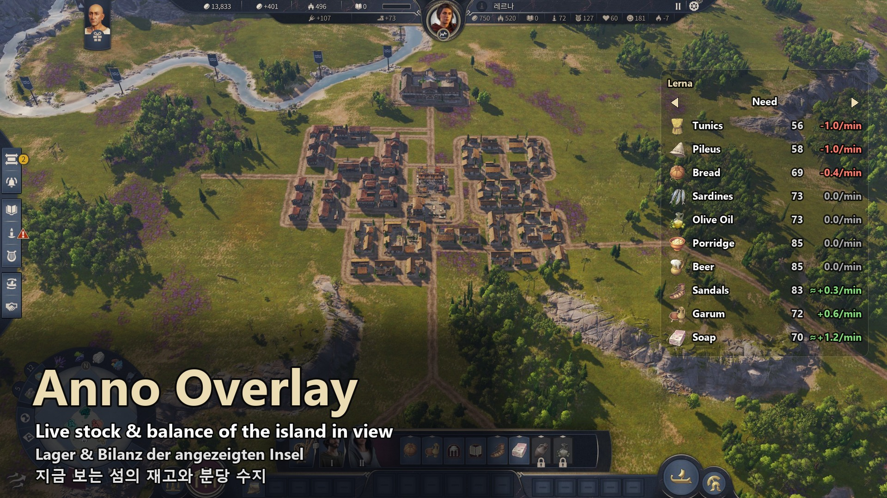

  

<h1 align="center">Anno Overlay</h1>

  <b>Live stock and per-minute balance of the island you are looking at — for Anno 117: Pax Romana</b>

  
  
  
  

  <a href="#english">English</a> · <a href="#deutsch">Deutsch</a> · <a href="#한국어">한국어</a>

  

## English

A small transparent overlay in the top-right corner of the screen. Move the camera to one of your islands and it shows every good there: stock, and whether it is going up or down per minute.

### Features

- **Goods** — Need · Raw Material · Intermediate Product · Construction Material, switched with ◀ ▶. Red = short, green = surplus, grey = even.
- **Short only** — ▽ hides everything that isn't running out.
- **Trade Routes** — ships at this island with their cargo, goods on their way here, goods picked up here.
- **Game numbers** — the balance comes from the game's own statistics (`/pipe` or the statistics screen). Before that arrives, it is estimated from stock changes, shown as `≈`.
- **Stays out of the way** — hides over the sea, on other players' islands and when the game isn't the active window. Each section can be minimized.
- **12 languages**, following the game's text language. Update notification in the tray.

### Download

The overlay has two parts:

| Part | What it does | Get it |
|---|---|---|
| **Mod** `[Tool] Anno Overlay` | reads the game data | [mod.io](https://mod.io/g/anno-117-pax-romana/m/tool-anno-overlay), or `anno-overlay-freej85-<version>.zip` from [Releases](https://github.com/FreeJ85/anno-overlay/releases/latest) |
| **Program** `AnnoOverlay.exe` | draws the overlay | [Releases](https://github.com/FreeJ85/anno-overlay/releases/latest) (mod.io doesn't allow program files) |

### Quick start

1. Install the mod: subscribe on mod.io, or unzip it into `Documents\Anno 117 - Pax Romana\mods`.
2. Download `AnnoOverlay.exe` and put it in any folder.
3. Run it. It stays in the system tray. If Windows says "Windows protected your PC", click **More info → Run anyway** (the program isn't code-signed).
4. Start the game with the mod enabled, in **Windowed** or **Borderless window** mode.
5. Recommended: add the launch option `/pipe` (Steam: Library → Anno 117 → Properties → General → Launch options).

**Exit:** right-click the tray icon → Exit. **Uninstall:** delete `AnnoOverlay.exe` and the mod. The mod only reads data and is safe to remove from a running save.

### Troubleshooting

- **Nothing shows up** — check that the game isn't in exclusive fullscreen, the mod is enabled, and `AnnoOverlay.exe` is running (tray icon).
- **Values marked `≈`** — that's the estimate before the game statistics arrive. Add `/pipe` or open the statistics screen once.
- **Items from other mods** — only base game and official DLC goods are known for now.

Questions and reports: [mod.io comments](https://mod.io/g/anno-117-pax-romana/m/tool-anno-overlay#discussion). Changes in each version: [Releases](https://github.com/FreeJ85/anno-overlay/releases).

---

## Deutsch

Ein kleines, durchsichtiges Overlay oben rechts. Sobald die Kamera auf einer deiner Inseln ist, zeigt es jede Ware dort: Lager und Bilanz pro Minute.

<b>Funktionen · Download · Schnellstart</b>

### Funktionen

- **Waren** — Bedarf · Rohstoff · Zwischenprodukt · Baumaterial, umschalten mit ◀ ▶. Rot = knapp, grün = Überschuss, grau = ausgeglichen.
- **Nur knapp** — ▽ blendet alles aus, was nicht ausgeht.
- **Handelsrouten** — Schiffe an dieser Insel mit Ladung, Waren auf dem Weg hierher, hier abgeholte Waren.
- **Zahlen aus dem Spiel** — die Bilanz kommt aus der Spielstatistik (`/pipe` oder Statistikmenü). Bis dahin wird sie aus der Lageränderung geschätzt, angezeigt als `≈`.
- **Stört nicht** — verborgen über dem Meer, auf fremden Inseln und wenn das Spiel nicht aktiv ist. Jeder Bereich lässt sich minimieren.
- **12 Sprachen**, passend zur Textsprache des Spiels. Hinweis im Infobereich bei neuer Version.

### Download

| Teil | Aufgabe | Bezug |
|---|---|---|
| **Mod** `[Tool] Anno Overlay` | liest die Spieldaten | [mod.io](https://mod.io/g/anno-117-pax-romana/m/tool-anno-overlay) oder die zip aus [Releases](https://github.com/FreeJ85/anno-overlay/releases/latest) |
| **Programm** `AnnoOverlay.exe` | zeichnet das Overlay | [Releases](https://github.com/FreeJ85/anno-overlay/releases/latest) |

### Schnellstart

1. Mod installieren: auf mod.io abonnieren oder nach `Dokumente\Anno 117 - Pax Romana\mods` entpacken.
2. `AnnoOverlay.exe` herunterladen, Ordner egal.
3. Starten. Es bleibt im Infobereich. Bei „Der Computer wurde durch Windows geschützt“ auf **Weitere Informationen → Trotzdem ausführen** klicken (nicht signiert).
4. Spiel mit aktivierter Mod im Modus **Fenster** oder **Rahmenloses Fenster** starten.
5. Empfohlen: Startoption `/pipe` (Steam: Bibliothek → Anno 117 → Eigenschaften → Allgemein → Startoptionen).

**Beenden:** Rechtsklick auf das Symbol im Infobereich → Beenden.

---

## 한국어

화면 오른쪽 위의 작은 투명 오버레이입니다. 카메라를 내 섬에 두면 그 섬 물품마다 재고와 분당 수지를 보여 줍니다.

<b>기능 · 받기 · 사용법</b>

### 기능

- **물품** — 요구 · 원자재 · 중간재 · 건축 자재를 ◀ ▶ 로 바꿈. 빨강 = 부족, 초록 = 남음, 회색 = 그대로.
- **부족만 보기** — ▽ 를 누르면 줄어드는 것만.
- **무역로** — 이 섬에 있는 배와 짐, 이 섬으로 오는 중인 물품, 여기서 실어 가는 물품.
- **게임 숫자 그대로** — 수지는 게임 통계(`/pipe` 또는 통계창)에서 옵니다. 그 전에는 재고 변화로 계산한 근사치가 `≈` 와 함께 나옵니다.
- **방해하지 않음** — 바다, 남의 섬, 게임이 활성 창이 아닐 때는 숨김. 칸마다 최소화.
- **12개 언어** — 게임 글자 언어를 따름. 새 버전이 나오면 트레이 알림.

### 받기

| 구성 | 하는 일 | 받는 곳 |
|---|---|---|
| **모드** `[Tool] Anno Overlay` | 게임 데이터를 읽음 | [mod.io](https://mod.io/g/anno-117-pax-romana/m/tool-anno-overlay) 또는 [Releases](https://github.com/FreeJ85/anno-overlay/releases/latest) 의 zip |
| **프로그램** `AnnoOverlay.exe` | 오버레이를 그림 | [Releases](https://github.com/FreeJ85/anno-overlay/releases/latest) |

### 사용법

1. 모드 설치: mod.io 구독, 또는 `문서\Anno 117 - Pax Romana\mods` 에 압축 풀기.
2. `AnnoOverlay.exe` 받기. 아무 폴더에 둬도 됩니다.
3. 실행하면 트레이에 머뭅니다. "Windows의 PC 보호" 가 뜨면 **추가 정보 → 실행** (코드 서명이 없어서).
4. 모드를 켜고 **창 모드** 또는 **테두리 없는 창** 으로 게임 시작.
5. 권장: 실행 옵션 `/pipe` (Steam: 라이브러리 → Anno 117 → 속성 → 일반 → 실행 옵션).

**끄기:** 트레이 아이콘 오른쪽 클릭 → 종료.

---

Fan-made tool, not affiliated with Ubisoft. Anno is a trademark of Ubisoft Entertainment.
